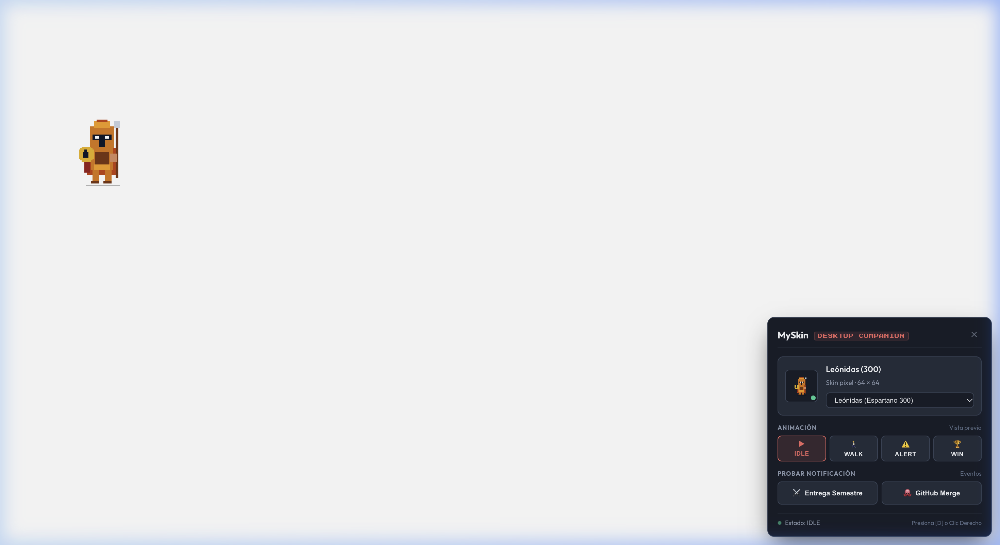
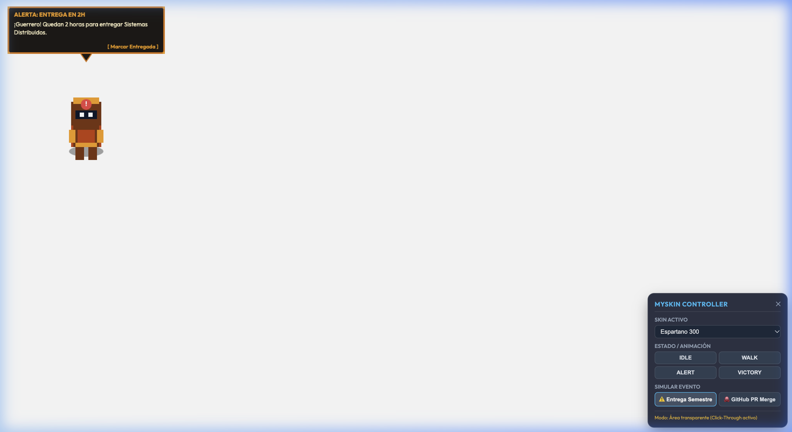
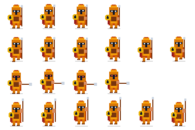
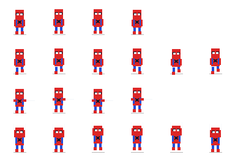

# MySkin

> Desktop Companion en Pixel Art con ventana transparente, click-through nativo a nivel de sistema operativo y arquitectura de skins modulares. Desarrollado con Tauri v2, Rust, TypeScript y HTML5 Canvas.

---

## 1. Resumen y Filosofia del Proyecto

MySkin es un laboratorio de ingenieria enfocado en interfaces de escritorio de bajo consumo, renderizado de sprites en tiempo real y comunicacion bidireccional entre el sistema operativo y la web.

A diferencia de soluciones pesadas basadas en Electron que empaquetan un navegador Chromium completo, MySkin utiliza **Tauri v2** y el motor nativo del sistema operativo (`WKWebView` en macOS). El resultado es un ejecutable compacto con un consumo inferior a 15 MB de memoria RAM y una carga de CPU cercana a cero en estado de reposo.

La estetica sigue el principio **Pixel Minimal UI**: figuras pequenas en pixel art con siluetas claras y animaciones fluidas a 60 FPS, acompanadas de un panel de control sobrio, compacto y de baja saturacion visual.

---

## 2. Capturas del Sistema

### Vista General: Personaje Activo y Controlador


*El personaje reposa flotando sobre el escritorio mientras el controlador permite supervisar estados y alternar paquetes de apariencia.*

### Globo de Notificacion Integrado en Canvas


*Al recibir un evento de deadline o integracion continua, el globo se dibuja en el mismo buffer grafico y se vuelve clicable de forma automatica mediante hit-testing por canal alfa.*

---

## 3. Arquitectura del Sistema

El proyecto esta organizado en tres capas independientes:

```
+------------------------------------------------------------------+
|                   SISTEMA OPERATIVO (macOS)                      |
|                                                                  |
|   +----------------------------------------------------------+   |
|   |                  CORE NATIVO (RUST / TAURI)               |   |
|   |  - NSWindow transparente y Always-on-Top                  |   |
|   |  - set_ignore_cursor_events (Click-through dinamico)     |   |
|   |  - get_cursor_rel_pos (Deteccion con Retina scale_factor)|   |
|   +----------------------------+-----------------------------+   |
|                                | IPC (Tauri Commands)            |
|   +----------------------------v-----------------------------+   |
|   |               MOTOR VISUAL (TYPESCRIPT / CANVAS)         |   |
|   |  - Maquina de Estados Finitos (FSM: IDLE, WALK, ALERT)   |   |
|   |  - Hit-Testing O(1) sobre buffer Uint8ClampedArray       |   |
|   |  - Renderizado sin suavizado (imageSmoothingEnabled)     |   |
|   +----------------------------+-----------------------------+   |
|                                | JSON Manifests & Texturas       |
|   +----------------------------v-----------------------------+   |
|   |              PAQUETES DE SKINS (PUBLIC/SKINS)            |   |
|   |  - manifest.json (definicion de estados, FPS y escala)    |   |
|   |  - spritesheet.png (grilla de animacion en canal alfa)   |   |
|   +----------------------------------------------------------+   |
+------------------------------------------------------------------+
```

### Tabla de Responsabilidades

| Capa | Tecnologia | Responsabilidad Tecnica |
|---|---|---|
| **Core Nativo** | Rust 2021 + Tauri v2 | Administracion de ventana transparente, escala fisica a logica Retina, puente de eventos de cursor. |
| **Motor Grafico & FSM** | TypeScript + HTML5 Canvas | Bucle de animacion sincronizado con delta-time, cache de colisiones por pixel, dibujo del globo de texto. |
| **Controlador** | CSS Grid/Flexbox + DOM | Interfaz Pixel Minimal UI para alternar skins, simular payloads y depurar transiciones. |
| **Capa de Skins** | JSON + Texturas PNG | Formato de paquetes desacoplado para importar nuevos personajes sin recompilar el core. |

---

## 4. Retos del Sistema Operativo y Solucion Implementada

### El problema del mousemove en ventanas click-through
Cuando una aplicacion de escritorio ejecuta `window.set_ignore_cursor_events(true)`, el sistema operativo deja de entregar eventos de mouse al WebView. La ventana se vuelve un fantasma total y deja de recibir `mousemove` en JavaScript, impidiendo saber cuando el usuario vuelve a pasar el cursor sobre el personaje.

### La solucion: Polling de bajo consumo a nivel de SO
Para solucionar este cuello de botella sin degradar la bateria:

1. **Consulta directa al SO:** El comando Rust `get_cursor_rel_pos` consulta `window.cursor_position()` y `window.outer_position()`.
2. **Normalizacion Retina:** Convierte los pixeles fisicos del monitor a pixeles logicos del canvas dividiendo entre `scale_factor`:
   $$\text{rel\_x} = \frac{\text{cursor.x} - \text{win\_pos.x}}{\text{scale}}$$
3. **Mapeo $O(1)$ de opacidad:** En TypeScript, se consulta el canal alfa del pixel bajo el cursor en el arreglo `Uint8ClampedArray` del frame activo:
   $$\text{alpha\_index} = (y \times \text{WIDTH} + x) \times 4 + 3$$
4. **Filtro de transmision IPC:** El comando `set_ignore_cursor` solo se emite cuando el booleano `shouldIgnore` cambia de valor, evitando saturar el puente IPC.

---

## 5. Especificacion del Sistema de Skins

Cada personaje reside en una subcarpeta dentro de `public/skins/` y contiene dos archivos: `manifest.json` y `spritesheet.png`.

El proyecto cuenta con el catalogo oficial de **10 personajes de lanzamiento**, estructurado en 3 Olas tematicas para pruebas graduales de fisica, animacion y viralidad:

### Ola 1: El Core y Navegacion (Los Fundacionales)
*Enfocados en calibrar la escala del canvas, la fisica de colisiones y el modo de arrastre y anclaje.*

1. **Leónidas (`spartan`) - El Espartano de 300**
   * **Visual:** Casco corintio de bronce con cresta roja, capa escarlata, escudo dorado y lanza de acero.
   * **Alertas (Semestre):** Alza su escudo y apunta con la lanza en guardia de combate.
   * **Celebraciones (GitHub):** Golpea su lanza contra el suelo en saludo espartano victorioso.
   * **Modo Concentracion (Focus):** Sentado en un taburete de bronce revisando un pergamino de estrategia militar.
   * **Modo Reposo (Sleep):** Apoyado sobre su escudo dorado con ojos cerrados.
   * **Personalidad:** Epico, marcial y exigente. *"¡A las armas! Tienes 1 hora para tu entrega o el semestre caera."*

2. **Spider-Hero (`spiderman`) - El Amistoso Vecino**
   * **Visual:** Traje rojo y azul pixelado, postura agil en cuclillas con ojos blancos triangulares.
   * **Alertas (Semestre):** Se cuelga de cabeza de la parte superior del globo o apunta con lanzarredes.
   * **Celebraciones (GitHub):** Lanza una telaraña al aire y realiza un giro acrobatico en el aire.
   * **Modo Concentracion (Focus):** Colgado boca abajo leyendo un libro de estudio.
   * **Modo Reposo (Sleep):** Acurrucado en una pequeña hamaca de telaraña tejida.
   * **Personalidad:** Relajado, juvenil e ironico. *"Oye, mi sentido aracnido dice que ese commit esta tardando. ¿Vamos a movernos o que?"*

3. **Mi Avatar Pixelado (`dev-avatar`) - Tu Mismo**
   * **Visual:** Ropa casual con sudadera navy, audifonos cian de diadema, vaqueros y zapatillas blancas.
   * **Alertas (Semestre):** Expresion de alarma sosteniendo una taza de cafe caliente derramandose.
   * **Celebraciones (GitHub):** Brazos alzados al cielo con lluvia de confeti de colores.
   * **Modo Concentracion (Focus):** Tecleando intensamente en un portatil plateado con pantalla de codigo matrix.
   * **Modo Reposo (Sleep):** Dormido sobre el teclado del computador.
   * **Personalidad:** Identificable, estresado y apasionado. *"¡Uff, menos mal que pusimos ese commit! Una mas para el portafolio."*

4. **El Dev Fantasma (`ghost-dev`) - Especial de Codigo**
   * **Visual:** Sabana espectral flotante blanca con ojos celestes pixelados y portatil miniatura.
   * **Alertas (Semestre):** Se vuelve de color rojo titilante con temblor de panico.
   * **Celebraciones (GitHub):** Se disuelve en particulas de codigo verde y reaparece triunfal.
   * **Modo Concentracion (Focus):** Flotando estatico con su pantalla emitiendo resplandor verde.
   * **Modo Reposo (Sleep):** Acurrucado en forma de esfera translucida flotando pacificamente.
   * **Personalidad:** Nerd, espectral y divertido. *"He visto muchos bugs en el mas alla, pero esta entrega de verdad te va a perseguir si no la haces hoy."*

### Ola 2: Entretenimiento y Memes (Los Virales)
*Disenados para capturar atencion en redes sociales por su potencial humoristico y referencias de cultura digital.*

5. **El Futbolista 10 (`football-10`) - La Pulga**
   * **Visual:** Camiseta albiceleste con el dorsal numero 10 dorado, pantalon negro y balon clasico.
   * **Alertas (Semestre):** Dominadas y toques rapidos de balon en cuenta regresiva.
   * **Celebraciones (GitHub):** Su iconico festejo senalando al cielo con ambos dedos indices.
   * **Modo Concentracion (Focus):** Sentado sobre el balon estudiando una pizarra con esquemas tacticos.
   * **Modo Reposo (Sleep):** Apoyando la cabeza sobre el balon usandolo como almohada.
   * **Personalidad:** Tranquilo, humilde y motivador. *"Falta poco para que termine el partido. Metamosle este commit y nos llevamos los tres puntos."*

6. **Capibara Chill (`capybara`) - La Mascota de Internet**
   * **Visual:** Roedor marron de silueta cuadrada con una naranja fresca equilibrada en la cabeza.
   * **Alertas (Semestre):** La naranja cae rodando y muestra ojos de sorpresa pixelada.
   * **Celebraciones (GitHub):** Se relaja dentro de una tina de madera (onsen) con destellos de vapor.
   * **Modo Concentracion (Focus):** Con gafas cuadradas de lectura revisando serenamente un libro.
   * **Modo Reposo (Sleep):** Tendido completamente plano en el suelo con la naranja a un lado.
   * **Personalidad:** Ultra-relajado, zen y sabio. *"Amigo, no te estreses, pero hay que entregar eso. Todo va a salir bien, solo dale push."*

7. **Cyber Ninja (`cyber-ninja`) - Accion y Sigilo**
   * **Visual:** Traje oscuro de operaciones tacticas, visor digital cian y bufanda de energia violeta.
   * **Alertas (Semestre):** Adopta guardia de combate y desenfunda una katana de plasma brillante.
   * **Celebraciones (GitHub):** Arroja bombas de humo pixeladas y adopta una pose ninja victoriosa.
   * **Modo Concentracion (Focus):** Meditacion en posicion de loto con orbes de datos flotantes.
   * **Modo Reposo (Sleep):** Apoyado en sigilo con el visor cian en standby atenuado.
   * **Personalidad:** Rapido, enfocado y sigiloso. *"El objetivo de tu semestre esta a la vista. Ejecuta el ataque sin dejar rastro de bugs."*

### Ola 3: Nostalgia y Cultura Pop (Fantasia y Exploracion)
*Dirigidos a los aficionados del pixel art tradicional, los RPGs retro y la ciencia ficcion.*

8. **Mago de Fantasía (`fantasy-wizard`) - El Hechicero**
   * **Visual:** Tunica violeta oscuro, sombrero de punta con hebilla dorada, barba blanca y baculo magico.
   * **Alertas (Semestre):** Levita un grimorio arcano con auras de fuego y runas brillantes.
   * **Celebraciones (GitHub):** Lanza chispas magicas y fuegos artificiales de colores con el baculo.
   * **Modo Concentracion (Focus):** Grimorio abierto flotando mientras canaliza mana de estudio.
   * **Modo Reposo (Sleep):** Inclinado sobre su baculo con el sombrero caido tapandole los ojos.
   * **Personalidad:** Sabio, misterioso y dramatico. *"Las runas del semestre auguran peligro... ¡Haz esa entrega antes de que el tiempo se desvanezca!"*

9. **Slime de Videojuego (`game-slime`) - La Mascota Rebotadora**
   * **Visual:** Gota gelatinosa verde esmeralda con reflejos brillantes y ojos redondos.
   * **Alertas (Semestre):** Se torna rojo furioso e infla sus mejillas en senal de maxima urgencia.
   * **Celebraciones (GitHub):** Se divide en tres mini-slimes felices rebotando al unisono.
   * **Modo Concentracion (Focus):** Se solidifica en un cubo regular usando pequenas gafas de pasta.
   * **Modo Reposo (Sleep):** Se disuelve suavemente en un charco plano de gelatina.
   * **Personalidad:** Tierno, burbujeante y animado. *"*Plop, plop* ¡Vamos! ¡Tu puedes con esa tarea! ¡Mucho animo!"*

10. **Astronauta Perdido (`astro-lost`) - Explorador Espacial**
    * **Visual:** Traje espacial blanco, mochila de soporte vital, parches de mision y visor dorado.
    * **Alertas (Semestre):** Enciende propulsores auxiliares con una luz de baliza roja titilante.
    * **Celebraciones (GitHub):** Planta una bandera del proyecto sobre el escritorio y realiza un saludo militar.
    * **Modo Concentracion (Focus):** Examina una tableta estelar con cartas de navegacion orbital.
    * **Modo Reposo (Sleep):** Flotando ingravido en gravedad cero con balizas apagadas.
    * **Personalidad:** Tecnologico, curioso y lejano. *"Houston, tenemos un problema si no entregas eso pronto... ¡Iniciemos la secuencia de push!"*

### Formato de `manifest.json`

```json
{
  "id": "spartan",
  "name": "Leonidas (El Espartano de 300)",
  "frameWidth": 64,
  "frameHeight": 64,
  "scale": 2,
  "anchorY": 85,
  "personalityPrompt": "Notificaciones epicas, marciales y directas. Enfocado en la disciplina de estudio y victoria en codigo.",
  "dialogues": {
    "alert": "¡A las armas! Tienes 1 hora para tu entrega o el semestre caera.",
    "victory": "¡Ahu, Ahu! Pull Request mezclado con honor espartano.",
    "focus": "¡Posiciones de falange! 25 minutos de estudio inquebrantable.",
    "break": "Descanso merecido, guerrero. Bebe agua y afila tu lanza.",
    "sleep": "Recuperando fuerzas para la proxima batalla academica..."
  },
  "states": {
    "IDLE": { "row": 0, "frames": 4, "fps": 6, "loop": true },
    "WALK": { "row": 1, "frames": 6, "fps": 10, "loop": true },
    "ALERT_SEMESTRE": { "row": 2, "frames": 4, "fps": 8, "loop": true },
    "VICTORY_GITHUB": { "row": 3, "frames": 6, "fps": 12, "loop": false, "nextState": "IDLE" },
    "FOCUS": { "row": 4, "frames": 4, "fps": 6, "loop": true },
    "SLEEP": { "row": 5, "frames": 4, "fps": 4, "loop": true }
  }
}
```

### Grilla del Spritesheet

Las dimensiones del archivo `spritesheet.png` responden al numero maximo de cuadros por fila multiplicado por el tamano de cuadro:

- **Fila 0 ($Y = 0$):** Estado `IDLE` (4 cuadros de respiracion y reposo).
- **Fila 1 ($Y = 64$):** Estado `WALK` (6 cuadros de ciclo de caminata).
- **Fila 2 ($Y = 128$):** Estado `ALERT_SEMESTRE` (4 cuadros en pose de guardia o alerta).
- **Fila 3 ($Y = 192$):** Estado `VICTORY_GITHUB` (6 cuadros de celebracion).

#### Spritesheet del Espartano (384 x 256 px)


#### Spritesheet de Spider-Man (384 x 256 px)


---

## 6. Especificacion Visual: Pixel Minimal UI

El panel de control adopta un lenguaje visual utilitario y oscuro, pensado para convivir con herramientas de desarrollo sin generar distraccion.

| Token | Valor Hex | Uso Principal |
|---|---|---|
| `--bg-dark` | `#181D29` | Fondo principal del controlador y tarjeta de miniatura. |
| `--surface-card` | `#252D3B` | Superficie de controles, chips y contenedores de accion. |
| `--surface-hover` | `#2F394A` | Estado hover de botones y elementos interactivos. |
| `--border-subtle` | `#3A4558` | Lineas divisorias de 1 px y contornos estructurales. |
| `--border-focus` | `#52627A` | Contorno de foco y acentuacion de seleccion. |
| `--accent-primary` | `#F16A64` | Color de enfasis, badges activos y alertas urgentes. |
| `--accent-gold` | `#E5A93C` | Acento secundario para notificaciones de plazo regular. |
| `--text-main` | `#F3F5F9` | Tipografia de alta legibilidad en titulos y etiquetas. |
| `--text-muted` | `#8D99AE` | Metadatos tecnicos, subtitulos y atajos de teclado. |

### Tipografia
- **Cuerpo y Controles:** `Outfit` / `Inter` para maxima legibilidad en tamanos pequenos (9 px a 12 px).
- **Indicadores Tecnicos:** `Press Start 2P` exclusivamente para codigos de estado (`00`, `01`, `SEM`, `GIT`).

### Modos de Comportamiento y Locomocion
- **Modo Anclado / Fijo (Pinned - Por Defecto):** El personaje reposa exactamente donde lo ubiques, respirando en estado `IDLE`. No se desplaza solo para no distraer durante sesiones de programacion o estudio.
- **Modo Libre / Patrulla (Free Roam):** Al alternar con clic derecho, el personaje cobra vida propia caminando de un lado a otro sobre la pantalla con pausas aleatorias de descanso.
- **Interrupcion Inteligente:** Al llegar una notificacion de entrega o de GitHub, la locomocion se detiene de forma instantanea para permitir la lectura y el clic sobre el globo de dialogo.
- **Arrastre 1:1 por Puntero (Drag & Drop):** Arrastre directo en puntos logicos (normalizado para pantallas Retina) con captura de puntero (`setPointerCapture`). Sigue al cursor de forma instantanea sin retraso ni efecto de media velocidad.
- **Proteccion de Bordes y Auto-Elevacion:** El sistema calcula las coordenadas para que el personaje nunca se pierda fuera de la pantalla. Si el personaje esta descansando cerca del borde inferior del monitor y se abre el controlador, la ventana se eleva automaticamente hacia arriba para que el panel quede 100% visible sin cortarse.
- **Eliminacion de Pared Invisible Superior:** Limites calibrados para permitir que el casco del personaje alcance el borde de la barra de menu de macOS sin topes artificiales.

### Interaccion y Atajos
- **Doble Clic sobre el Personaje:** Abre o repliega el panel de control MySkin Controller.
- **Clic Izquierdo Sostenido sobre el Personaje:** Inicia el arrastre manual nativo 1:1 por la pantalla.
- **Arrastre desde el Controlador:** Permite mover la ventana arrastrando desde el encabezado (`MySkin DESKTOP COMPANION`) o desde la tarjeta del personaje.
- **Clic Derecho sobre el Personaje:** Alterna entre Modo Fijo (Anclado) y Modo Libre (Patrulla).
- **Atajo `Cmd + Shift + D` (Mac) / `Ctrl + Shift + D`:** Alterna el controlador de forma segura sin interferir al escribir codigo en el IDE.
- **Tecla `Escape` o Boton `✕`:** Cierran el controlador y devuelven la ventana a su tamano compacto.
- **Flechas Direccionales:** Desplazan al personaje con animacion de caminata continua a 10 FPS (pasos de 22 px, o 45 px manteniendo `Shift`).
- **Clic sobre el Globo de Dialogo:** Descarta la notificacion activa y reanuda el estado normal.

---

## 7. Requisitos y Configuracion

### Requisitos Previos
- **Node.js:** v18.0 o superior (verificado con v20+).
- **Rust Toolchain:** `rustc` y `cargo` v1.75+ (verificado con Rust 1.99.0 en arquitectura Apple Silicon aarch64).
- **macOS:** 12.0 o superior para compatibilidad con `macOSPrivateApi` de transparencia.

### Instalacion

Clonar el repositorio e instalar las dependencias de Node:

```bash
git clone https://github.com/luisrodriguez-rgb/My-Skin.git
cd MySkin
npm install
```

Verificar la compilacion del backend de Rust:

```bash
source "$HOME/.cargo/env"
cargo check --manifest-path src-tauri/Cargo.toml
```

---

## 8. Modos de Ejecucion

### Modo Simulación Web (Desarrollo y Diseno de Skins)
Ejecuta el servidor Vite local para calibrar sprites, probar la FSM y verificar la paleta visual desde cualquier navegador:

```bash
npm run dev
```

Abre `http://localhost:5173/`. Desde la consola de desarrollador puedes invocar directamente:

```javascript
window.testAlert();           // Dispara notificacion de entrega academica
window.testVictory();         // Dispara notificacion de GitHub PR
window.loadSkin("spiderman"); // Carga el paquete de Spider-Man
window.setPetState("WALK");   // Fuerza la animacion de caminata
```

### Modo Nativo de Escritorio (Tauri v2)
Compila el binario en modo depuracion y levanta la ventana flotante con soporte completo de transparencia y click-through sobre macOS:

```bash
source "$HOME/.cargo/env"
./node_modules/.bin/tauri dev
```

---

## 9. Hoja de Ruta Tecnica (Roadmap)

Para consultar el analisis critico de ingenieria, el diagnostico de deuda tecnica y la planificacion detallada por fases, revisa el documento [Auditoria Tecnica y Roadmap Estrategico](docs/AUDIT_AND_ROADMAP.md).

1. [x] Creacion del proyecto con Tauri v2 y ventana flotante transparente.
2. [x] Comando nativo en Rust para hit-testing y gestion de click-through.
3. [x] Motor de renderizado en Canvas con FSM desacoplada a 60 FPS.
4. [x] Rediseño del controlador bajo estetica Pixel Minimal UI.
5. [x] Estandarizacion de skins modulares (`manifest.json` y `spritesheet.png`).
6. [x] Soporte de arrastre 1:1 en pantallas Retina y auto-elevacion de ventana.
7. [x] Catalogo oficial de 10 personajes de lanzamiento (Ola 1, Ola 2, Ola 3).
8. [x] Sintetizador de audio retro 8-bits nativo con Web Audio API.
9. [x] Sistema de concentracion Pomodoro (25 min foco / 5 min descanso) y estados FOCUS / SLEEP.
10. [x] Dialogos contextuales y deteccion de inactividad por personaje.
11. [ ] **Modulo de Sincronizacion en Tiempo Real (Fase 2):** Cliente WebSocket / SSE para enlazar con la API de entregas universitarias.
12. [ ] **Integracion con GitHub (Fase 2):** Webhook listener o polling ligero sobre GitHub GraphQL API para monitorear estados de PRs y CI.
13. [ ] **Desacoplamiento Multi-Ventana / Tray (Fase 4):** Ventana overlay para el sprite y ventana nativa/system tray para ajustes.
14. [ ] **Empaquetado y Distribucion (Fase 4):** Binarios firmados .dmg y .msi mediante GitHub Actions.

---

## 10. Licencia

Distribuido bajo licencia MIT. Consulta el archivo `LICENSE` para mas informacion.
