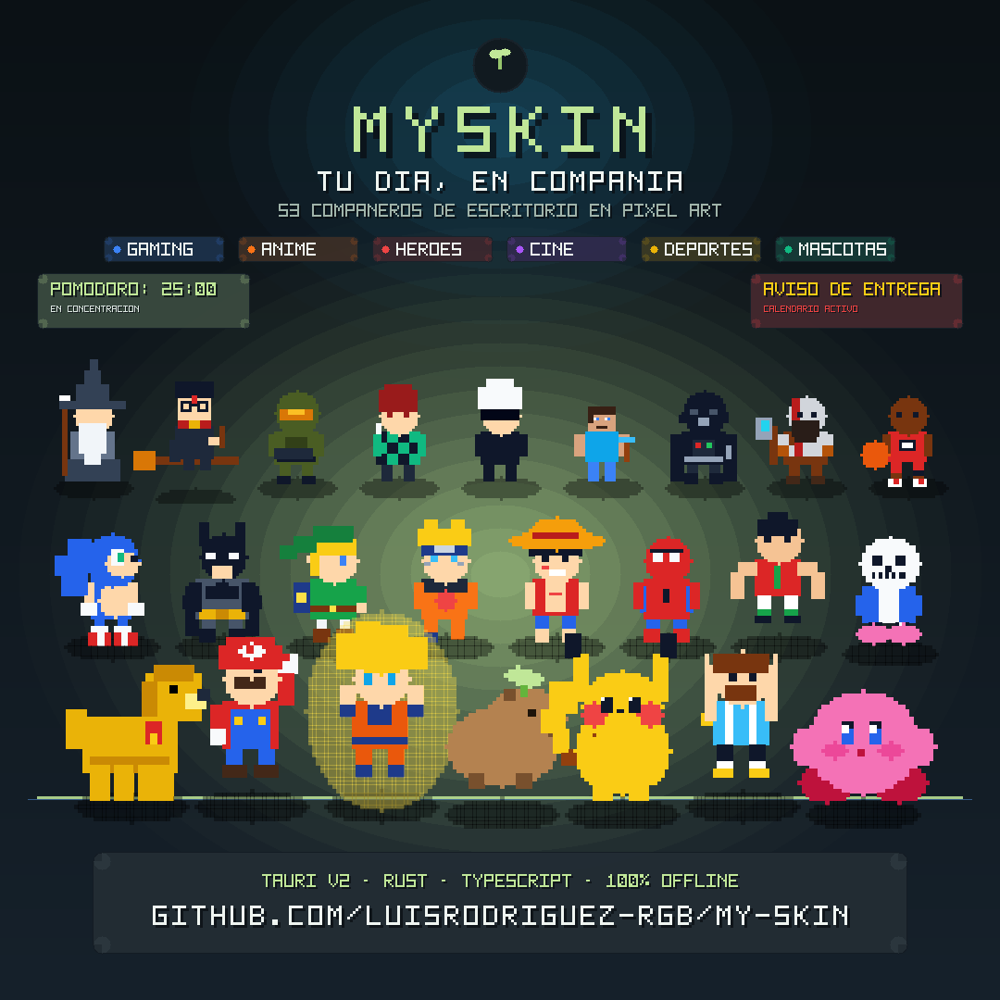

<div align="center">
  
  <h1>MySkin</h1>
  <p><strong>Un compañero en pixel art para estudiar, concentrarte y seguir tus entregas.</strong></p>
  <p>Personajes de escritorio · Pomodoro · Calendario académico · Avisos de GitHub</p>
  <p>Construido con Tauri v2, Rust, TypeScript y Canvas.</p>
</div>

Elige un personaje, inicia una sesión de concentración y consulta lo próximo que
tienes que entregar. MySkin reúne ese flujo en un controlador y lo acompaña con
un personaje flotante, animaciones y audio retro.

Las vistas **Hoy, Compañeros y Ajustes** y la nueva identidad verde ya están
integradas en `main`. El logo representa un compañero pixel con un brote: pequeños
pasos, foco y crecimiento.

[Empezar](#empezar-en-modo-web) · [Pruebas](#validación) ·
[Roadmap](docs/AUDIT_AND_ROADMAP.md) ·
[Auditoría y capturas](docs/audits/2026-10-15/README.md)

## Qué puedes hacer

| Función | Comportamiento actual |
| -------------------------------- | ----------------------------------------------------------------------------------------------------------------------------------- |
| **Elegir compañero** | Catálogo expandido de 53 skins clasificadas en 7 categorías (Mascotas, Superhéroes, Cine, Anime, Videojuegos, Cartoons, Deportes) con buscador en tiempo real y barra de filtros accesible. |
| **Concentrarte** | Pomodoro de 25 minutos de foco y 5 de descanso, con pausa, reanudación y reinicio. Cerrar el controlador conserva la sesión. |
| **Consultar entregas** | Importar un calendario `.ics` o `webcal://` y ver curso, título, fecha y tiempo restante. |
| **Actuar sobre una tarea** | Marcarla como completada en MySkin o abrir su enlace HTTP(S) en el navegador. Las completadas se conservan al resincronizar. |
| **Recibir avisos** | Alertas para entregas pendientes que vencen dentro de dos horas, con datos reales y una lista de avisos que puedes descartar. |
| **Seguir GitHub** | Detección de merges y del último commit observado, con deduplicación, cursor por repositorio y respeto de límites de consultas. |
| **Ajustar el personaje** | Audio retro, modo fijo o patrulla y controles de demostración dentro de Pruebas avanzadas. |

Las entregas urgentes tienen prioridad sobre los avisos de Pomodoro, GitHub y
ambientales. Un evento de menor prioridad espera en la cola; su duración comienza
a contar mientras está visible. Después de un aviso temporal, el personaje
recupera el estado de la sesión de concentración.

**Completar una tarea se guarda localmente en MySkin:** no envía trabajos ni
modifica el estado de entrega en Canvas, Moodle u otro LMS.

## Así se ve

<p align="center">
  
</p>

<p align="center">
  
</p>

Captura de la aplicación en simulación web y escritorio, con entregas de ejemplo y zona horaria
de Bogotá. También puedes ver la [galería de compañeros](docs/images/companions-current.png),
los [ajustes](docs/images/settings-current.png) y la [vista a 390 px](docs/images/today-390.png).
La [demostración animada del personaje](docs/images/demo.webp) y el
[registro de las siete correcciones](docs/audits/2026-10-15/CORRECCIONES.md)
complementan esta vista.

### Tres vistas para el día a día

| Pestaña | Qué reúne |
| --------------------- | ------------------------------------------------------------------------------------------------------ |
| **Hoy** | Próxima entrega, compañero protagonista, Pomodoro, lista de tareas, resumen del calendario y avisos. |
| **Compañeros** | Galería de los 53 personajes con buscador en vivo, chips de categorías, vista previa y selección activa. |
| **Ajustes** | Sonido, modo fijo/patrulla, calendario, repositorio de GitHub y pruebas avanzadas. |

Cambiar de pestaña conserva el reloj y los borradores de conexión. Puedes navegar
con flechas izquierda/derecha y `Inicio`/`Fin` cuando una pestaña tiene el foco.

## Empezar en modo web

Necesitas **Node.js 24.19.0** y **pnpm 11.25.0**, declarados en
[`.node-version`](.node-version) y [`package.json`](package.json).

```bash
git clone https://github.com/luisrodriguez-rgb/My-Skin.git
cd My-Skin
pnpm install --frozen-lockfile
pnpm run dev
```

1. Abre `http://localhost:5173/` para ver al personaje.
2. Haz doble clic sobre él para abrir el controlador, o abre
   `http://localhost:5173/controller.html` en otra pestaña.
3. Elige un personaje en **Compañeros** y vuelve a **Hoy** para pulsar **Concentrarme**.
4. En **Ajustes**, pega la URL de suscripción y pulsa **Sincronizar calendario** para cargar
   las entregas. Una instalación nueva comienza sin tareas de ejemplo.

Mantén **una sola pestaña del personaje por origen**. Esa ventana ejecuta los
servicios y el reloj; el controlador muestra su estado y le envía acciones.
La simulación web permite probar el flujo de producto. La transparencia, el
arrastre de ventanas, la patrulla del escritorio y el menú del sistema se ejecutan
en Tauri.

El monitor de GitHub utiliza por defecto `luisrodriguez-rgb/My-Skin`. En
**Ajustes → GitHub** puedes elegir un repositorio público con el formato
`propietario/repositorio`. La configuración de tokens para recursos privados
sigue disponible mediante la API de [`src/githubMonitor.ts`](src/githubMonitor.ts).

## Ejecutar en escritorio (macOS)

MySkin cuenta con soporte nativo de primera clase para macOS (Apple Silicon e Intel). Para ejecutar el compañero flotante con ventana transparente, arrastre nativo y controles de sistema:

### 1. Prerrequisitos en macOS

- **Node.js** (v24+) y gestor de paquetes (`npm` o `pnpm`).
- **Rust estable y Cargo**: instalados mediante `rustup` (`rustc --version` y `cargo --version`).
- Herramientas de desarrollo de macOS: `xcode-select --install`.

### 2. Modo desarrollo nativo en Mac

Compila el backend en Rust e inicia el compañero de escritorio junto con el controlador:

```bash
npm run tauri dev
```

*(o `pnpm tauri dev`)*

Este comando:

1. Ejecuta el servidor frontend local en `http://localhost:5173`.
2. Compila el binario nativo de Rust con Tauri v2.
3. Abre la ventana flotante transparente del personaje en tu pantalla y el menú del sistema.

### 3. Compilar el paquete de aplicación para macOS (.app y .dmg)

Para generar el ejecutable nativo optimizado para macOS sin necesidad de servidores locales ni terminal:

```bash
npm run tauri build
```

*(o `pnpm tauri build`)*

Los artefactos compilados se generan automáticamente en:

- **Aplicación macOS**: `src-tauri/target/release/bundle/macos/MySkin.app`
- **Instalador de disco**: `src-tauri/target/release/bundle/dmg/MySkin_0.1.0_aarch64.dmg` *(o x64)*

### 4. Abrir directamente la aplicación instalada en macOS

Una vez compilada, puedes iniciarla inmediatamente desde la terminal con:

```bash
open src-tauri/target/release/bundle/macos/MySkin.app
```

O bien copiar `MySkin.app` a tu carpeta `/Applications`.

### 5. Verificación del backend Rust

Para verificar la sintaxis y tipos de Rust sin levantar interfaz gráfica:

```bash
cargo check --manifest-path src-tauri/Cargo.toml
```

### Controles de escritorio

| Acción                                           | Control                                                                        |
| ------------------------------------------------- | ------------------------------------------------------------------------------ |
| Abrir u ocultar el controlador                    | Doble clic en el personaje o menú del sistema.                                |
| Abrir u ocultar el controlador desde el personaje | `Cmd/Ctrl + Shift + D`.                                                      |
| Ocultar el controlador                            | `Escape` o cierre de su ventana.                                             |
| Mover el personaje                                | Arrastrar sobre su zona visible o usar las flechas; `Shift` amplía el paso. |
| Alternar fijo / patrulla                          | Clic derecho en el personaje, botón de modo o menú del sistema.              |
| Descartar un aviso                                | Clic en el globo o botón Descartar en el controlador.                         |

Los atajos actúan sobre la ventana enfocada. Con el canvas enfocado, `Enter` o
espacio descartan el aviso visible o abren el controlador.

## Validación

El proyecto cuenta con una suite completa de pruebas unitarias y de integración end-to-end con Chromium:

| Comprobación | Resultado |
| --------------------------------------------- | ------------------------------------------------------------------------------------------------------------------------------------------ |
| Servicios, calendarios, prioridades y enlaces | **44 pruebas unitarias aprobadas** (Vitest). |
| Flujos de personaje y controlador en Chromium | **14 pruebas E2E aprobadas** (Playwright), cubriendo el catálogo completo de 53 compañeros. |
| Tipos y empaquetado de las dos entradas | **TypeScript y Vite aprobados** sin advertencias. |
| Accesibilidad automatizada del panel | Sin infracciones de Axe en las tres pestañas examinadas, incluyendo validación de formularios y controles avanzados. |
| Adaptación a ventanas estrechas | Sin desbordamiento horizontal a 280, 390 y 560 px; controles principales de al menos 40 px de alto. |
| Integración continua (CI) | Pipeline automatizado en GitHub Actions con validación web y `cargo check` multiplataforma (macOS ARM/Intel y Windows). |

[Ver estado de CI en GitHub Actions](https://github.com/luisrodriguez-rgb/My-Skin/actions).

Para ejecutar las comprobaciones:

```bash
pnpm exec playwright install chromium
pnpm check
```

También puedes ejecutar `pnpm test`, `pnpm run build` y `pnpm run test:e2e`
por separado. Las pruebas E2E levantan su propio servidor en el puerto **4173**.
En el entorno cloud con Chromium del sistema:

```bash
PLAYWRIGHT_CHROMIUM_EXECUTABLE=/usr/bin/chromium pnpm run test:e2e
```

## Arquitectura y skins

La ventana **`main`** es la autoridad del estado: posee el Pomodoro, los servicios
de calendario y GitHub, la cola de avisos y las preferencias. La ventana
**`controller`** envía comandos y renderiza snapshots de `AppState`.
El transporte utiliza eventos Tauri en escritorio y `BroadcastChannel` entre
pestañas del mismo origen en web.

| Ruta                                                                                            | Responsabilidad                                                                  |
| ----------------------------------------------------------------------------------------------- | -------------------------------------------------------------------------------- |
| [`src/main.ts`](src/main.ts)                                                                   | Canvas, animación, interacción y coordinación del estado.                     |
| [`src/controller.ts`](src/controller.ts)                                                       | Entregas, formularios, galería, avisos y controles del panel.                   |
| [`src/controllerTabs.ts`](src/controllerTabs.ts) y [`src/controller.css`](src/controller.css) | Navegación accesible y diseño de las tres vistas.                              |
| [`src/skinCatalog.ts`](src/skinCatalog.ts)                                                     | Catálogo y caché de vistas previas.                                            |
| [`src/notifications.ts`](src/notifications.ts)                                                 | Prioridades y duración de los avisos.                                           |
| [`src/pomodoro.ts`](src/pomodoro.ts)                                                           | Reloj basado en tiempo real y fases de concentración/descanso.                  |
| [`src/calendar.ts`](src/calendar.ts) y [`src/syncService.ts`](src/syncService.ts)             | Análisis con `ical.js`, sincronización, urgencia y persistencia de entregas. |
| [`src/githubMonitor.ts`](src/githubMonitor.ts)                                                 | Consultas, cursores y deduplicación de actividad GitHub.                        |
| [`src/platform.ts`](src/platform.ts)                                                           | Adaptación del transporte entre escritorio y web.                               |
| [`src-tauri/`](src-tauri/)                                                                     | Ventanas nativas, comandos y menú del sistema.                                  |
| [`public/skins/`](public/skins/)                                                               | Manifiestos y texturas de los 53 personajes organizados por categorías.          |

### Catálogo de compañeros (53 skins)

El catálogo de MySkin reúne **53 personajes icónicos en pixel art** organizados en siete categorías temáticas:

| Categoría | Personajes incluidos |
| :--- | :--- |
| **Mascotas y Vida** (7) | Capibara Chill (`capybara`), Labrador Retriever (`labrador-retriever`), Lily Estudiante (`little-girl`), Gato Negro (`cat-mystic`), Shiba Inu (`shiba-inu`), Panda Zen (`panda-zen`), Pingüino Antártico (`arctic-penguin`). |
| **Superhéroes** (6) | Spider-Hero (`spiderman`), Capitán América (`captain-america`), Iron Man (`iron-man`), Thor Odinson (`thor-odinson`), Batman (`batman-detective`), Superman (`superman-man-of-steel`). |
| **Cine y Fantasía** (8) | Harry Potter (`harry-potter`), Lord Voldemort (`lord-voldemort`), Mago de Fantasía (`fantasy-wizard`), Leónidas (`spartan`), Astronauta Perdido (`astro-lost`), Darth Vader (`darth-vader`), Maestro Yoda (`master-yoda`), Gandalf el Gris (`gandalf-grey`). |
| **Anime y Manga** (11) | Cyber Ninja (`cyber-ninja`), Son Goku (`son-goku`), Príncipe Vegeta (`vegeta-prince`), Naruto Uzumaki (`naruto-uzumaki`), Monkey D. Luffy (`monkey-d-luffy`), Roronoa Zoro (`roronoa-zoro`), Satoru Gojo (`satoru-gojo`), Tanjiro Kamado (`tanjiro-kamado`), Nezuko Kamado (`nezuko-kamado`), Saitama (`saitama-hero`), Capitán Levi (`levi-ackerman`). |
| **Videojuegos** (13) | Tu Avatar (`dev-avatar`), Dev Fantasma (`ghost-dev`), Slime (`game-slime`), Super Mario (`super-mario`), Link - Héroe del Tiempo (`link-hero`), Pikachu (`pikachu-electric`), Sonic the Hedgehog (`sonic-hedgehog`), Kirby (`kirby-dream`), Mega Man (`mega-man-blue`), Master Chief (`master-chief-117`), Kratos (`kratos-war`), Sans el Esqueleto (`sans-undertale`), Steve (`steve-craft`). |
| **Cartoons y Series** (3) | Bugs Bunny (`bugs-bunny`), Bob Esponja (`spongebob-square`), Rick Sanchez (`rick-sanchez`). |
| **Deportes y Leyendas** (5) | El Futbolista 10 (`football-10`), Neymar Jr. (`neymar-jr`), Lionel Messi (`lionel-messi`), Cristiano Ronaldo (`cristiano-cr7`), Michael Jordan (`michael-jordan-23`). |

Cada carpeta en `public/skins/[id]/` contiene su `manifest.json` y `spritesheet.png` de 384x384 px (grilla 64x64 de 6 filas y 6 columnas). Cada skin implementa los seis estados de animación estándar:
- `IDLE`: Parpadeo y respiración de reposo (4 frames, 6 fps).
- `WALK`: Desplazamiento lateral (6 frames, 10 fps).
- `ALERT_SEMESTRE`: Reacción ante entregas próximas a vencer (4 frames, 8 fps).
- `VICTORY_GITHUB`: Celebración al completar tareas o recibir merges (6 frames, 12 fps).
- `FOCUS`: Concentración activa durante el Pomodoro (4 frames, 6 fps).
- `SLEEP`: Reposo y siesta (4 frames, 4 fps).

La animación respeta los FPS de cada estado y se coordina mediante `requestAnimationFrame`. La galería del panel de control incluye buscador por texto en tiempo real y selector toolbar de categorías.

## Límites actuales y próximos pasos

- Reiniciar toda la aplicación reinicia el Pomodoro y la cola de avisos. Las
  preferencias y las entregas completadas permanecen en almacenamiento local.
- Los calendarios deben permitir acceso por CORS. Las recurrencias se expanden
  hasta 90 días y los TZID requieren su definición `VTIMEZONE`. Una descarga
  fallida conserva los datos; un calendario válido vacío los reemplaza.
- GitHub necesita un token para recursos privados. Los tokens nuevos configurados
  mediante la API viven durante la sesión; el almacén seguro del sistema sigue
  pendiente. El monitor de commits notifica el último SHA observado.
- Las pruebas interactivas nativas, varios monitores y escalas, consumo de CPU,
  memoria y energía, firma y notarización requieren validación adicional.

El siguiente paso es completar la matriz de escritorio y probar calendarios reales.
La navegación **Hoy / Compañeros / Ajustes** ya está integrada. La creación manual
de tareas, el historial de sesiones/minutos y los controles adicionales de
tranquilidad del prototipo quedan para próximas iteraciones.

## Documentación del proyecto

- [Auditoría técnica y roadmap con criterios de aceptación](docs/AUDIT_AND_ROADMAP.md).
- [Auditoría de producto y propuesta visual](docs/audits/2026-10-15/README.md).
- [Siete correcciones implementadas y evidencia](docs/audits/2026-10-15/CORRECCIONES.md).
- [Fase 2: navegación, decisiones y capturas](docs/PHASE_2_HOY.md).
- [Matriz de validación nativa](docs/NATIVE_VALIDATION.md).
- [Codebase Memory: instalación y uso](docs/CODEBASE_MEMORY.md).
- [Decisiones de arquitectura](.codebase-memory/adr.md).
- [Identidad visual y archivos del logo](docs/BRANDING.md).
- [Historial de cambios](CHANGELOG.md).

## Licencia
 
Distribuido bajo la [Licencia MIT](LICENSE). Código libre y abierto para la comunidad estudiantil y desarrolladora.
