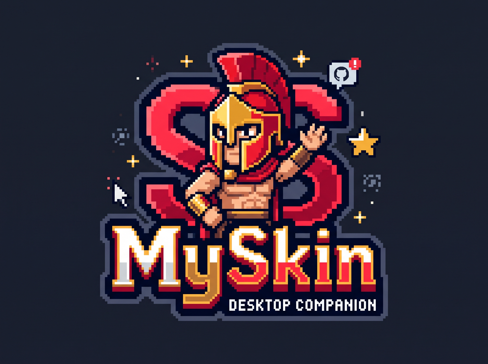
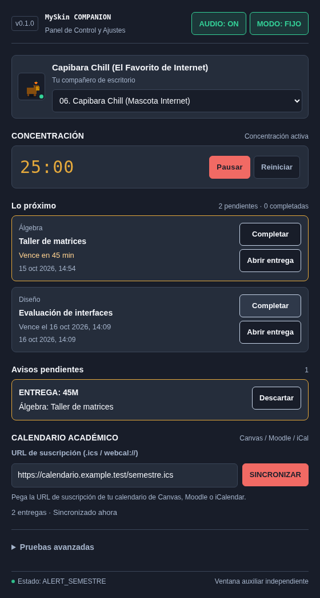

<div align="center">
  
  <h1>MySkin</h1>
  <p><strong>Un compañero en pixel art para estudiar, concentrarte y seguir tus entregas.</strong></p>
  <p>Personajes de escritorio · Pomodoro · Calendario académico · Avisos de GitHub</p>
  <p>Construido con Tauri v2, Rust, TypeScript y Canvas.</p>
</div>

Elige un personaje, inicia una sesión de concentración y consulta lo próximo que
tienes que entregar. MySkin reúne ese flujo en un controlador y lo acompaña con
un personaje flotante, animaciones y audio retro.

La estabilización actual se encuentra en la rama
[`feat/estabilizacion-myskin`](https://github.com/luisrodriguez-rgb/My-Skin/tree/feat/estabilizacion-myskin),
con revisión en el [PR #1](https://github.com/luisrodriguez-rgb/My-Skin/pull/1).

[Empezar](#empezar-en-modo-web) · [Pruebas](#validación) ·
[Roadmap](docs/AUDIT_AND_ROADMAP.md) ·
[Auditoría y capturas](docs/audits/2026-10-15/README.md)

## Qué puedes hacer

| Función | Comportamiento actual |
| --- | --- |
| **Elegir compañero** | Diez skins con vista previa, seis estados de animación y selección persistente. |
| **Concentrarte** | Pomodoro de 25 minutos de foco y 5 de descanso, con pausa, reanudación y reinicio. Cerrar el controlador conserva la sesión. |
| **Consultar entregas** | Importar un calendario `.ics` o `webcal://` y ver curso, título, fecha y tiempo restante. |
| **Actuar sobre una tarea** | Marcarla como completada en MySkin o abrir su enlace HTTP(S) en el navegador. Las completadas se conservan al resincronizar. |
| **Recibir avisos** | Alertas para entregas pendientes que vencen dentro de dos horas, con datos reales y una lista de avisos que puedes descartar. |
| **Seguir GitHub** | Detección de merges y del último commit observado, con deduplicación, cursor por repositorio y respeto de límites de consultas. |
| **Ajustar el personaje** | Audio retro, modo fijo o patrulla y controles de demostración dentro de Pruebas avanzadas. |

Las entregas urgentes tienen prioridad sobre los avisos de Pomodoro, GitHub y
ambientales. Un evento de menor prioridad espera en la cola; su duración comienza
a contar mientras está visible. Después de un aviso temporal, el personaje
recupera el estado de la sesión de concentración.

**Completar una tarea se guarda localmente en MySkin:** no envía trabajos ni
modifica el estado de entrega en Canvas, Moodle u otro LMS.

## Así se ve

<p align="center">
  
</p>

Captura de la aplicación en simulación web, con entregas de ejemplo y zona horaria
de Bogotá. La [demostración animada del personaje](docs/images/demo.webp) y el
[registro de las siete correcciones](docs/audits/2026-10-15/CORRECCIONES.md)
complementan esta vista.

## Empezar en modo web

Necesitas **Node.js 24.19.0** y **pnpm 11.25.0**, declarados en
[`.node-version`](.node-version) y [`package.json`](package.json).

```bash
git clone --branch feat/estabilizacion-myskin https://github.com/luisrodriguez-rgb/My-Skin.git
cd My-Skin
pnpm install --frozen-lockfile
pnpm run dev
```

1. Abre `http://localhost:5173/` para ver al personaje.
2. Haz doble clic sobre él para abrir el controlador, o abre
   `http://localhost:5173/controller.html` en otra pestaña.
3. Elige un compañero y pulsa **Concentrarme** para iniciar el Pomodoro.
4. Pega la URL de suscripción de tu calendario y pulsa **Sincronizar** para cargar
   las entregas. Una instalación nueva comienza sin tareas de ejemplo.

Mantén **una sola pestaña del personaje por origen**. Esa ventana ejecuta los
servicios y el reloj; el controlador muestra su estado y le envía acciones.
La simulación web permite probar el flujo de producto. La transparencia, el
arrastre de ventanas, la patrulla del escritorio y el menú del sistema se ejecutan
en Tauri.

El monitor de GitHub utiliza por defecto `luisrodriguez-rgb/My-Skin`. Cambiar el
repositorio o configurar un token se realiza mediante la API del servicio en
[`src/githubMonitor.ts`](src/githubMonitor.ts); todavía no hay un formulario de
conexión en el controlador.

## Ejecutar en escritorio

Además de Node y pnpm, instala Rust estable y los
[prerrequisitos oficiales de Tauri para tu plataforma](https://v2.tauri.app/start/prerequisites/).
Desde el checkout con las dependencias instaladas:

```bash
pnpm run build
cargo check --locked --manifest-path src-tauri/Cargo.toml
pnpm tauri dev
```

Usa este modo como alternativa al servidor de simulación: ambos utilizan el
puerto 5173. Para generar el paquete nativo de tu plataforma:

```bash
pnpm tauri build
```

Los targets de CI son **macOS Apple Silicon, macOS Intel y Windows x64**. La
compilación está comprobada; las interacciones de escritorio siguen la
[matriz de validación nativa](docs/NATIVE_VALIDATION.md).

A 15 de octubre de 2026 no hay releases publicadas. El
[workflow de distribución](.github/workflows/release.yml) está preparado para
compilar paquetes; la firma, notarización y validación de instaladores están
pendientes.

### Controles de escritorio

| Acción | Control |
| --- | --- |
| Abrir u ocultar el controlador | Doble clic en el personaje o menú del sistema. |
| Abrir u ocultar el controlador desde el personaje | `Cmd/Ctrl + Shift + D`. |
| Ocultar el controlador | `Escape` o cierre de su ventana. |
| Mover el personaje | Arrastrar sobre su zona visible o usar las flechas; `Shift` amplía el paso. |
| Alternar fijo / patrulla | Clic derecho en el personaje, botón de modo o menú del sistema. |
| Descartar un aviso | Clic en el globo o botón Descartar en el controlador. |

Los atajos actúan sobre la ventana enfocada. Con el canvas enfocado, `Enter` o
espacio descartan el aviso visible o abren el controlador.

## Validación

Resultados registrados el **15 de octubre de 2026** para el código de la
estabilización en `756598a`:

| Comprobación | Resultado |
| --- | --- |
| Servicios, calendarios, prioridades y enlaces | **34 pruebas unitarias aprobadas**. |
| Flujos de personaje y controlador en Chromium | **11 pruebas E2E aprobadas**. |
| Tipos y empaquetado de las dos entradas | **TypeScript y Vite aprobados**. |
| Accesibilidad automatizada del panel | Sin infracciones de Axe en los estados examinados, con controles avanzados cerrados y abiertos. |
| Adaptación a ventanas estrechas | Sin desbordamiento horizontal a 280, 390 y 560 px; controles principales de al menos 40 px de alto. |
| CI remoto | **Web y `cargo check` aprobados en macOS ARM, macOS Intel y Windows**. |

[Ver la ejecución de CI](https://github.com/luisrodriguez-rgb/My-Skin/actions/runs/38790669286).
El análisis automático de accesibilidad cubre los estados probados; no constituye
una certificación completa. Las pruebas de red usan respuestas controladas y no
acreditan conexión con cuentas universitarias o repositorios privados.

Para ejecutar las comprobaciones:

```bash
pnpm exec playwright install chromium
pnpm check
```

También puedes ejecutar `pnpm test`, `pnpm run build` y `pnpm run test:e2e`
por separado. Las pruebas E2E levantan su propio servidor en el puerto **4173**.
En el entorno cloud con Chromium del sistema:

```bash
PLAYWRIGHT_CHROMIUM_EXECUTABLE=/usr/bin/chromium pnpm run test:e2e
```

## Arquitectura y skins

La ventana **`main`** es la autoridad del estado: posee el Pomodoro, los servicios
de calendario y GitHub, la cola de avisos y las preferencias. La ventana
**`controller`** envía comandos y renderiza snapshots de `AppState`.
El transporte utiliza eventos Tauri en escritorio y `BroadcastChannel` entre
pestañas del mismo origen en web.

| Ruta | Responsabilidad |
| --- | --- |
| [`src/main.ts`](src/main.ts) | Canvas, animación, interacción y coordinación del estado. |
| [`src/controller.ts`](src/controller.ts) | Entregas, formularios, avisos y controles del panel. |
| [`src/notifications.ts`](src/notifications.ts) | Prioridades y duración de los avisos. |
| [`src/pomodoro.ts`](src/pomodoro.ts) | Reloj basado en tiempo real y fases de concentración/descanso. |
| [`src/calendar.ts`](src/calendar.ts) y [`src/syncService.ts`](src/syncService.ts) | Análisis con `ical.js`, sincronización, urgencia y persistencia de entregas. |
| [`src/githubMonitor.ts`](src/githubMonitor.ts) | Consultas, cursores y deduplicación de actividad GitHub. |
| [`src/platform.ts`](src/platform.ts) | Adaptación del transporte entre escritorio y web. |
| [`src-tauri/`](src-tauri/) | Ventanas nativas, comandos y menú del sistema. |
| [`public/skins/`](public/skins/) | Manifiestos y texturas de los diez personajes. |

El catálogo incluye **Leónidas, Spider-Hero, Mi Avatar Pixelado, El Dev Fantasma,
El Futbolista 10, Capibara Chill, Cyber Ninja, Mago de Fantasía, Slime de Videojuego
y Astronauta Perdido**. Cada carpeta contiene `manifest.json` y `spritesheet.png`.
El [manifiesto de Leónidas](public/skins/spartan/manifest.json) muestra el formato
actual: tamaño de cuadro, escala y configuración de los seis estados `IDLE`,
`WALK`, `ALERT_SEMESTRE`, `VICTORY_GITHUB`, `FOCUS` y `SLEEP`.

La animación respeta los FPS de cada estado y se coordina mediante
`requestAnimationFrame`. La importación de skins desde la interfaz y el editor
visual forman parte de la evolución prevista.

## Límites actuales y próximos pasos

- Reiniciar toda la aplicación reinicia el Pomodoro y la cola de avisos. Las
  preferencias y las entregas completadas permanecen en almacenamiento local.
- Los calendarios deben permitir acceso por CORS. Las recurrencias se expanden
  hasta 90 días y los TZID requieren su definición `VTIMEZONE`. Una descarga
  fallida conserva los datos; un calendario válido vacío los reemplaza.
- GitHub necesita un token para recursos privados. Los tokens nuevos configurados
  mediante la API viven durante la sesión; el almacén seguro del sistema sigue
  pendiente. El monitor de commits notifica el último SHA observado.
- Las pruebas interactivas nativas, varios monitores y escalas, consumo de CPU,
  memoria y energía, firma y notarización requieren validación adicional.

El siguiente paso es completar la matriz de escritorio y probar calendarios reales.
La navegación **Hoy / Compañeros / Ajustes** está documentada como propuesta de
una próxima iteración.

## Documentación del proyecto

- [Auditoría técnica y roadmap con criterios de aceptación](docs/AUDIT_AND_ROADMAP.md).
- [Auditoría de producto y propuesta visual](docs/audits/2026-10-15/README.md).
- [Siete correcciones implementadas y evidencia](docs/audits/2026-10-15/CORRECCIONES.md).
- [Matriz de validación nativa](docs/NATIVE_VALIDATION.md).
- [Codebase Memory: instalación y uso](docs/CODEBASE_MEMORY.md).
- [Decisiones de arquitectura](.codebase-memory/adr.md).
- [Historial de cambios](CHANGELOG.md).

## Licencia

Licencia declarada: **MIT**. Falta incorporar el archivo `LICENSE` al repositorio.
