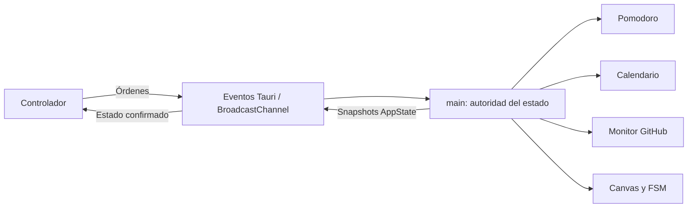

# MySkin: auditoría y roadmap de estabilización

Actualizado el 15 de octubre de 2026. Esta revisión sustituye los porcentajes de
avance y las cifras de rendimiento de la auditoría anterior. La presencia de
código no acredita su funcionamiento en una plataforma nativa.

## Objetivo de la beta

Un personaje de escritorio con diez skins, controlador independiente, Pomodoro
y notificaciones académicas correctas. El monitor de GitHub debe detectar merges
sin repetir notificaciones. Primero se estabiliza ese flujo; el importador de
skins y el autoactualizador quedan para después de una beta validada.

## Cambios implementados en este sprint

- Node 24.19.0 y pnpm 11.25.0 declarados. Instalación congelada con el lockfile de
  pnpm tanto en desarrollo como en CI y en el workflow de releases.
- Vite 6.4 para compatibilidad con el runner de pruebas. TypeScript sigue en modo
  estricto. El build genera las dos entradas, personaje y controlador.
- Adaptador `platform.ts`: eventos Tauri en escritorio y BroadcastChannel en la
  simulación web. El navegador no consulta el cursor mediante comandos nativos.
- La ventana `main` posee servicios, preferencias y el único temporizador de
  Pomodoro. El controlador envía órdenes y renderiza snapshots `AppState`;
  no crea su propio temporizador ni su propia copia del servicio académico.
- El controlador solicita el estado al abrirse y comprueba la conexión cada dos
  segundos. Reabrirlo no reinicia el Pomodoro. El reloj utiliza una fecha límite
  real y se actualiza tras suspensión o ralentización de temporizadores.
- Eliminadas referencias al panel integrado antiguo de `main.ts`. El comando
  nativo de visibilidad admite mostrar, ocultar o alternar y propaga errores.
- Capacidades explícitas para eventos del controlador y para las operaciones de
  ventana que utiliza el personaje. Su ejecución real requiere pruebas nativas.
- Sin tareas universitarias ficticias en instalaciones nuevas. Las acciones de
  demostración están identificadas como tales.
- Urgencia limitada a tareas futuras, pendientes y dentro de dos horas. Una
  tarea no dispara una alerta nueva en cada comprobación durante la sesión.
- Un calendario válido sin eventos reemplaza los datos anteriores. Una descarga
  fallida o un formato inválido conserva las tareas y la última URL válida.
  Cuando desaparece la tarea que originó la alerta, se retira esa notificación.
- iCalendar se analiza con `ical.js`, con casos de UTC, fecha completa con final
  exclusivo, líneas continuadas, RRULE, EXDATE, excepciones desplazadas y zonas
  incluidas mediante VTIMEZONE. Los IDs de ocurrencias son estables.
- GitHub consulta PRs ordenadas por actualización, pagina cuando hace falta,
  conserva un cursor por repositorio y deduplica merges. Respeta rate limits y
  evita consultas solapadas del mismo tipo.
- Los tokens nuevos de GitHub se mantienen sólo en memoria. Un token legado de
  localStorage se migra a la memoria de la sesión y se elimina del almacenamiento.
  No hay todavía integración con el almacén seguro del sistema operativo.
- Incorporadas pruebas de servicios y pruebas de navegador con las dos ventanas.
- Codebase Memory MCP 0.11.0 instalado en la nube, con habilidad local,
  instalador verificable y decisiones de arquitectura persistentes.

## Correcciones de producto de esta iteración

Se implementaron los siete hallazgos de la auditoría de producto: entregas
accionables, cola de prioridades, avisos con datos reales, una acción de
concentración, errores persistentes, contraste y controles accesibles.
El [registro de correcciones y capturas](audits/2026-10-15/CORRECCIONES.md)
relaciona cada hallazgo con su prueba. La navegación Hoy / Compañeros / Ajustes
ya está integrada en el panel; ver [Fase 2](PHASE_2_HOY.md).

## Arquitectura de estado

La simulación debe mantener una sola pestaña principal del personaje por origen.
Los controladores pueden cerrarse y reabrirse. El estado del Pomodoro vive en el
proceso principal: reiniciar toda la aplicación todavía reinicia la sesión de
concentración. Preferencias y entregas siguen persistidas en localStorage.

## Validación de este entorno

| Comprobación | Resultado |
| --- | --- |
| Pruebas unitarias de servicios, cola de avisos y enlaces | 34 aprobadas |
| Pruebas de Chromium con personaje y controlador | 14 aprobadas |
| Accesibilidad automatizada del panel poblado | Sin infracciones en los estados examinados; sin desbordamiento a 280/390/560 px |
| Compilación TypeScript y Vite | Aprobada |
| Descarga y checksum del instalador de Codebase Memory | Verificados |
| Ejecución de GitHub Actions | [Aprobada: web, macOS ARM/Intel y Windows](https://github.com/luisrodriguez-rgb/My-Skin/actions/runs/38789745833) |
| Interacciones reales de Tauri en macOS/Windows | Pendientes de validación en escritorio |
| Consumo nativo de RAM, CPU y energía | Sin medición |
| Firma, notarización y pruebas de instaladores | Pendientes |

Las pruebas de red usan respuestas controladas. No acreditan conexión con una
cuenta universitaria, permisos sobre un repositorio privado ni comportamiento de
un proveedor real. Los eventos de menú en Chromium prueban el contrato de eventos,
no la integración del menú con el sistema operativo.

## Límites actuales

- Calendarios: recurrencias expandidas a 90 días, con límite de 10 000 pasos por
  serie. Excederlo falla conservando datos anteriores. Los TZID necesitan su
  definición VTIMEZONE; se rechazan zonas sin definición para evitar horas erróneas.
- La descarga de calendarios sigue usando fetch: el proveedor debe permitir el
  acceso desde el WebView/navegador mediante CORS. Debe probarse con feeds reales.
- GitHub: máximo de diez páginas de cien PRs por consulta incremental. Si se
  supera, no avanza el cursor y `lastError` explica el límite. El monitor de
  commits notifica el último SHA observado, no todos los commits intermedios.
- Las alertas deduplicadas se recuerdan durante la sesión; el historial de
  entrega de notificaciones no persiste entre reinicios completos.
- El sondeo nativo de cursor es secuencial: aproximadamente 100 ms fuera de la
  ventana, 30 ms dentro y 120 ms sin consultar durante arrastre. Está pendiente
  medir el efecto real en latencia, CPU y energía.
- La máscara alfa aún se lee del canvas completo al redibujar. No se afirma
  muestreo por parches ni cero asignaciones. Los FPS son los de cada estado;
  requestAnimationFrame coordina el bucle, no obliga a redibujar a 60 FPS.
- Varios monitores, escalas diferentes y escritorios virtuales requieren pruebas
  de escritorio. Los atajos actuales son locales a la ventana enfocada.

## Roadmap de producto: avance de las fases 1 y 2

| Fase de producto | Estado | Criterio cubierto y seguimiento |
| --- | --- | --- |
| 1. Avisos correctos y legibilidad | Implementada y probada en web | Siete hallazgos corregidos, con pruebas de prioridades, tiempos y errores persistentes. |
| 2. Hoy y diseño del prototipo | Navegación y circuito con calendario implementados en web | Hoy, Compañeros y Ajustes conectados al estado real. Foco, pausa, completar, galería y formularios conservan contexto. 14 E2E, teclado y Axe en las tres vistas. |
| Ampliaciones del circuito diario | Pendientes | Tareas manuales, historial de sesiones/minutos y controles de tranquilidad adicionales. El resumen actual cuenta entregas reales del calendario. |

La [evidencia de Fase 2](PHASE_2_HOY.md) distingue la integración del panel de las
funciones adicionales que sólo existen en el prototipo. La validación de las
interacciones de escritorio sigue pendiente.

## Roadmap técnico con criterios de aceptación

| Fase | Estado | Trabajo y criterio de cierre |
| --- | --- | --- |
| 1. Base reproducible | Implementada y validada localmente | Instalación congelada, build y pruebas de web. CI remoto aprobado para web y cargo check en los tres targets. |
| 2. Estado consistente | Validada en simulación web | Una autoridad; reabrir controlador conserva reloj, skin y preferencias. Repetir matriz en Tauri nativo. |
| 3. Integraciones fiables | Correcciones principales implementadas | Casos de calendario y GitHub pasan con fixtures. Prioridades implementadas y probadas. Probar proveedores reales, CORS, límites y recuperación; decidir persistencia de avisos entre reinicios. |
| 4. Escritorio y rendimiento | Pendiente de ejecución nativa | Completar `NATIVE_VALIDATION.md` en macOS ARM, macOS Intel y Windows; adjuntar resultados y mediciones de reposo, animación y controlador. |
| 5. Beta distribuible | Pendiente | Validar instaladores limpios, identidad/firma por plataforma, notarización macOS, política de credenciales y documentación de soporte. |
| 6. Evolución | Posterior a beta | Importación segura de skins, editor visual, personalización y actualizaciones firmadas, cada una con sus propios criterios de aceptación. |

Las estimaciones originales de 3–5 días para la base y 1–2 semanas por fase son
orientativas para una persona con equipos de prueba disponibles. No constituyen
fechas comprometidas. No se marca una fase de escritorio como terminada por pasar
pruebas web.

## Próximo trabajo concreto

1. Ejecutar pruebas interactivas de escritorio en los tres targets. La
   compilación nativa ya pasó en el pipeline enlazado.
2. Probar el controlador real: eventos, permisos, menú, Escape, cierre y reapertura.
3. Probar feeds reales de Canvas/Moodle y definir transporte nativo si CORS impide
   el acceso. No guardar URLs privadas en fixtures ni en logs.
4. Medir RAM/CPU/energía con metodología y datos publicados antes de optimizar.
5. Preparar una beta de distribución sólo después de cerrar esa evidencia.
