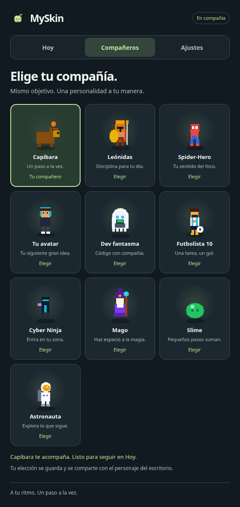
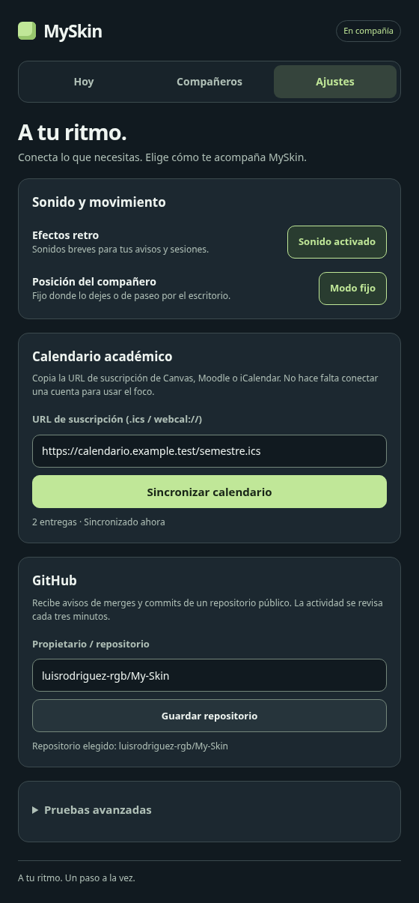

# Fase 2: Hoy, Compañeros y Ajustes

15 de octubre de 2026. Código de la integración: `893cfa4`. Rama:
`feat/circuito-diario-hoy`, basada en la estabilización integrada en main.

## Resultado

La estructura, paleta verde, tarjetas y galería de la
[propuesta visual](audits/2026-10-15/propuesta.html) están conectadas a la aplicación.
El controlador conserva su papel reactivo: las pestañas gestionan la vista,
y main conserva los servicios y el único reloj de Pomodoro.

| Vista | Comportamiento |
| --- | --- |
| Hoy | Recomienda la próxima entrega pendiente, muestra el compañero confirmado y el reloj; permite concentrarse, pausar, reiniciar, completar, abrir o descartar avisos. El resumen cuenta pendientes, completadas y entregas que vencen hoy en la zona local. |
| Compañeros | Diez tarjetas con sprites reales y personalidad breve. La selección se confirma con el estado publicado por main. Un fallo conserva el personaje anterior y muestra el error. |
| Ajustes | Sonido, fijo/patrulla, suscripción de calendario, repositorio público GitHub y controles de demostración en el apartado avanzado. |

Las pestañas admiten flechas izquierda/derecha, Inicio y Fin. Navegar conserva el
borrador del calendario, la validación y el reloj. El controlador puede abrirse
antes que el personaje: la navegación sigue disponible y las acciones se habilitan
cuando conecta con el propietario del estado. El primer snapshot tampoco borra
los borradores que se hayan escrito sin conexión.

## Validación

- **34 pruebas unitarias aprobadas** y build **TypeScript/Vite aprobado**.
- **14 E2E Chromium aprobadas**: las 11 regresiones adaptadas a pestañas y tres
  casos nuevos de teclado/borradores, repositorio GitHub y conexión tardía.
- **Axe sin infracciones detectadas** en las tres vistas examinadas.
- Sin desbordamiento horizontal a **280, 390 y 560 px**; controles principales
  de al menos 40 px y foco de teclado visible.
- [CI de esta rama](https://github.com/luisrodriguez-rgb/My-Skin/actions?query=branch%3Afeat%2Fcircuito-diario-hoy).
  El backend Rust no se modificó. Las interacciones nativas requieren la
  [matriz de escritorio](NATIVE_VALIDATION.md).

Las pruebas se ejecutaron por grupos: 11 regresiones y tres nuevos recorridos.
Las capturas siguientes se generaron en Chromium con calendario y respuestas de
GitHub controlados, en zona horaria de Bogotá. No contienen datos personales.

## Capturas de la aplicación

### Hoy

[Vista a 390 px](images/today-390.png).

### Compañeros

### Ajustes

## Decisiones y trabajo posterior

El resumen usa los datos existentes del calendario. La creación manual de tareas,
el historial de sesiones/minutos, el volumen, silencio temporal, reducción de
movimiento configurable y detección de presentaciones del prototipo requieren
servicios y pruebas adicionales; no se muestran como controles operativos.

Completar sigue siendo una acción local a MySkin. La configuración de tokens
privados se mantiene en la API del servicio, fuera del formulario de repositorios
públicos. La revisión nativa, proveedores reales/CORS y mediciones de recursos
conservan sus criterios pendientes.
