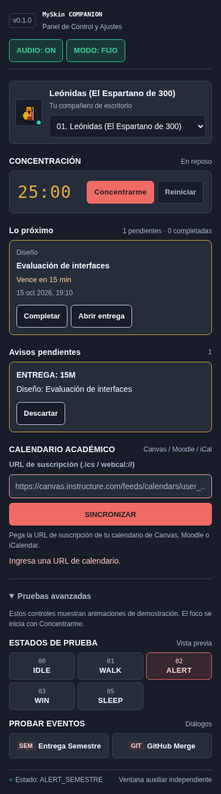
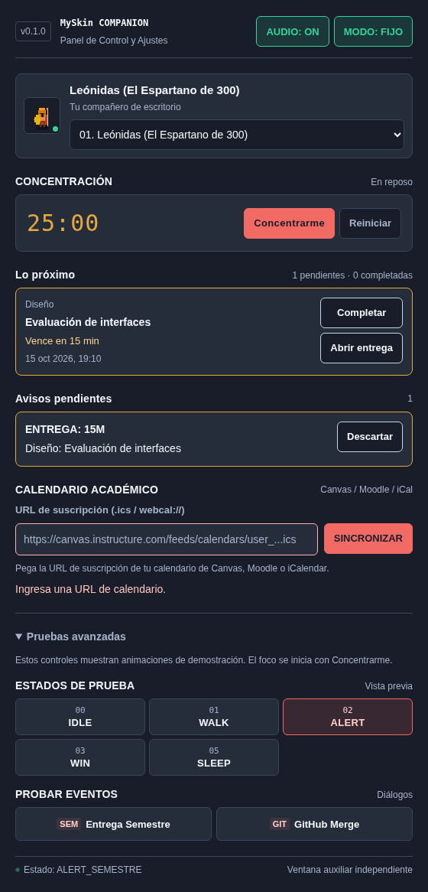

# Correcciones de los siete hallazgos

15 de octubre de 2026. Implementación web validada en `cc3da32` sobre
`feat/estabilizacion-myskin`. Se conserva la auditoría original como registro del
estado anterior. Las pestañas Hoy / Compañeros / Ajustes del prototipo quedan
para una iteración posterior, según el alcance elegido.

## Qué cambia para el usuario

| Hallazgo | Resultado implementado | Evidencia |
| --- | --- | --- |
| Calendario reducido a un contador | Lista con curso, título, fecha, tiempo restante y acciones Completar / Abrir entrega. Completar persiste al resincronizar y reabrir el panel. | Prueba E2E de entregas y pruebas de calendario/sincronización. |
| Celebraciones que borraban alertas | Cola compartida: entrega urgente > Pomodoro completado > GitHub > demostración > ambiental. Las entregas se ordenan por vencimiento y los avisos inferiores esperan. | Prueba E2E con dos entregas, fin de Pomodoro y merge simultáneos; seis pruebas unitarias de cola/contexto. |
| Diálogo con plazos ficticios | El aviso usa curso, título y minutos del vencimiento real, actualizados mientras está visible. Personaje y controlador redondean los minutos hacia arriba. | Caso E2E con entrega en 15 minutos y prueba unitaria de minutos parciales. |
| FOCUS separado del temporizador | Una acción Concentrarme inicia el Pomodoro. Pausar y reiniciar restauran reposo; una celebración temporal devuelve el personaje a concentración si la sesión sigue activa. | E2E de concentración, pausa, reanudación y restauración después de merge. |
| Validación borrada por el heartbeat | El error local permanece hasta editar el campo o reintentar. Los errores de carga de personaje también se muestran y conservan el personaje anterior. | E2E que espera más de dos segundos, recibe otro snapshot y comprueba el error; E2E de skin con HTTP 404. |
| Contraste y texto insuficientes | Texto secundario más claro, texto oscuro sobre coral y tamaños de lectura mayores. Foco visible y anuncios accesibles de acciones. | Axe en el panel con tareas, avisos y error, con pruebas avanzadas cerradas y abiertas. |
| Controles diminutos / desbordamiento | Audio, modo, Pomodoro y sincronización tienen al menos 40 px de alto. El contenido se adapta y permite desplazamiento vertical. | E2E sin desplazamiento horizontal a 280, 390 y 560 px; navegación de teclado. |

## Validación reproducible

- `pnpm test`: **34 pruebas aprobadas**.
- `pnpm run build`: **TypeScript y Vite aprobados**.
- `pnpm run test:e2e`: **11 pruebas aprobadas en Chromium**.
- Axe: **cero infracciones detectadas** para las etiquetas WCAG 2 A/AA,
  2.1 AA y 2.2 AA en los dos estados examinados. Esto no sustituye una revisión
  manual completa ni certifica toda la aplicación.
- [CI de la implementación](https://github.com/luisrodriguez-rgb/My-Skin/actions/runs/38789745833):
  **web y cargo check aprobados** para macOS ARM, macOS Intel y Windows.
  Esa ejecución valida el mismo backend Rust de esta entrega; la nube local no
  dispone de Rust. El ajuste posterior del texto de Pomodoro se validó de nuevo
  con las 34 pruebas unitarias, build y 11 E2E indicados arriba.

La prueba de prioridades también retrasa el aviso de fin de sesión hasta que
ya terminó el descanso; su texto sigue describiendo un hecho real.

Los feeds, enlaces y eventos de GitHub de las pruebas son controlados. No se
utilizan cuentas ni entregas personales. La apertura de enlaces en el navegador
web está probada; el comando de apertura en escritorio requiere comprobación
interactiva en cada sistema operativo.

## Capturas de la aplicación implementada

Estas capturas provienen de la prueba E2E y usan una entrega de ejemplo. Se
muestra intencionalmente la validación de URL vacía y el apartado avanzado abierto.
No son las pantallas del prototipo de diseño.

### Ventana de 390 px

### Ventana de 560 px

## Pendiente antes de una beta de escritorio

1. Ejecutar la [matriz nativa](../../NATIVE_VALIDATION.md): ventanas, clics,
   arrastre, escalas, menús y apertura de enlaces.
2. Probar calendarios reales, CORS y recuperación de conexión.
3. Medir CPU, memoria y energía en los tres targets.
4. Abordar la navegación visual del prototipo en otra iteración y después la
   firma, notarización y validación de instaladores.

Los avisos descartados y la cola viven durante la sesión; reiniciar todo el
proceso reinicia el Pomodoro y puede volver a mostrar alertas pendientes. Completar
una entrega se guarda localmente en MySkin; no la marca como entregada en el LMS.
