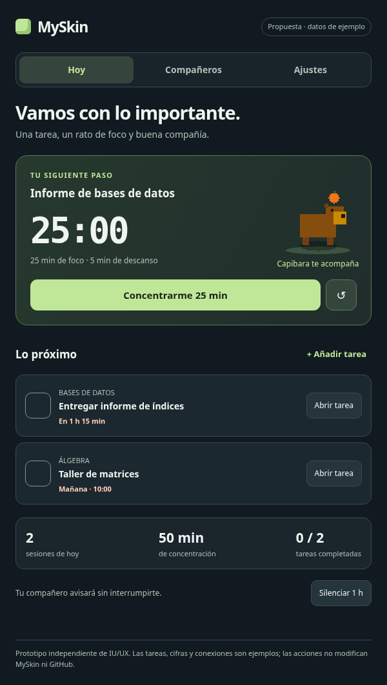
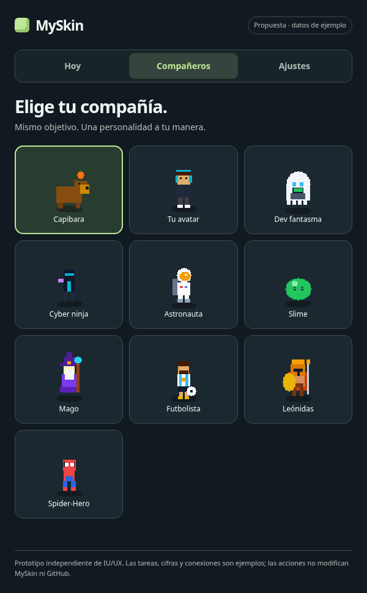

# Auditoría de producto y propuesta visual de MySkin

15 de octubre de 2026. Documentación y prototipo de diseño del commit `ec6e908`.

**Actualización:** [ver las siete correcciones implementadas y sus capturas](CORRECCIONES.md).

**Fase 2:** [ver Hoy, Compañeros y Ajustes implementados](../../PHASE_2_HOY.md).

## Abrir el contenido

- **[Leer el informe completo aquí en GitHub](INFORME.md)**
- **[Abrir el PDF con el informe y las capturas](MySkin-auditoria-y-propuesta.pdf)**
- **[Ver la propuesta de pantalla principal](propuesta-hoy.png)**
- **[Ver la galería de compañeros](propuesta-companeros.png)**
- **[Comparar con la interfaz actual](controller-default.png)**

Los archivos están en el repositorio. Para descargar uno, ábrelo y usa el botón
**Download raw file** de GitHub. El PDF contiene 11 páginas e incluye el informe
completo, la interfaz actual y las dos vistas principales de la propuesta.

## Propuesta: Hoy

## Propuesta: Compañeros

## Prototipo navegable

[Descargar el HTML autónomo](propuesta.html) y abrirlo con un navegador. GitHub
muestra el código HTML; no ejecuta el prototipo dentro de esta página. El archivo
incluye sus imágenes y no necesita instalar dependencias.

El prototipo es independiente de MySkin y utiliza datos de ejemplo. Sus acciones
no modifican la aplicación, las cuentas del usuario ni GitHub. El informe distingue
los resultados comprobados de las propuestas y las validaciones pendientes.

## Evidencia

- [Recorridos y resultados de accesibilidad](evidence.json)
- [Comprobaciones del prototipo](prototype-check.json)
